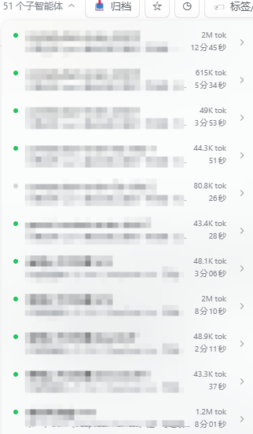
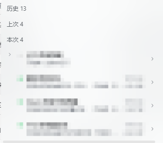

# @dsh-external/dsh-subagent-toolkit

[](https://github.com/Kadima-code/dsh-subagent-toolkit/releases) [](https://www.npmjs.com/package/dsh-subagent-toolkit) [](https://www.npmjs.com/package/dsh-subagent-toolkit) [](https://github.com/Kadima-code/dsh-subagent-toolkit/releases) [](https://github.com/Kadima-code/dsh-subagent-toolkit/blob/master/LICENSE) [](https://github.com/deepseek-ai/deepseek-harness)

给 [DeepSeek Harness](https://github.com/deepseek-ai/deepseek-harness)（DSH）用的**子代理下拉折叠**：把子代理按「使用批次」收进 **历史 / 今日 / 上次 / 本次** 四组，**本次始终展开**，其余可折叠。

**不改原版头部、不新增入口**——只在官方「子代理」下拉里加分组，按钮和布局一个都没动。

## 怎么用

1. **打开**：点官方「子代理」按钮（原版也支持悬停展开，插件不干预）。
2. **看分组**：最下面是「本次 N」标签 + 本次批次（始终展开）；上面依次是「上次 N / 今日 N / 历史 N」。
3. **折叠**：点任一分组头即展开/收起，标题只显示「名称 + 条数」。
4. **子代理会话内同样生效**：打开某个子代理会话时，它头部的上级/目录下拉也按同一规则分组。
5. **删除子代理**：每行尾部有「⋯」→「删除子智能体」，二次确认后删除（运行中会先停止）。删除后该行隐藏，「N 个子智能体」计数同步减。
6. **整组删除**：各组标题（历史/今日/上次/本次）右侧的「⋯」→「删除本组（N 个）」，一次删掉整组；交互与行内删除一致。
7. **子代理模型同步**：`list_subagent_models` 返回**当前**模型目录（不受会话创建时的旧快照限制）；`subagent` 的显式 `provider/model` 按实时目录校验后生效——主对话可以每次任务换不同模型。

| 分组 | 含义 | 默认 |
|---|---|---|
| **本次** | 最近一次使用子代理产生的那一批（并行发起算同一批） | 始终展开 |
| **上次** | 上一次使用子代理产生的那一批 | 折叠 |
| **今日** | 今天其余批次 | 折叠 |
| **历史** | 今天之前 | 折叠 |

> 「批次」按子代理创建时间聚合，间隔 ≤ **120 秒**视为同一批。

## 效果示意

```
子代理下拉
├ 历史 12        ← 折叠（点开）
├ 今日 5         ← 折叠
├ 上次 2         ← 折叠
└ 本次 3         ← 标签 + 始终展开
   ├ 任务 A      运行中
   ├ 任务 B
   └ 任务 C
```

### 截图（前后对比）

| 之前（51 条平铺） | 之后（分组折叠） |
|---|---|
|  |  |

## 安装

### npm（推荐）

已发布到 npm，一条命令装进 profile（会写依赖与 bundles）：

```bash
dsh plugin --profile desktop add dsh-subagent-toolkit
```

或手动：

```bash
cd "$env:USERPROFILE\.dsh\profiles\desktop"
pnpm add dsh-subagent-toolkit
```

然后在 profile 的 `package.json` 登记：

```json
{
  "dependencies": { "dsh-subagent-toolkit": "^0.0.3" },
  "dsh": { "profile": { "bundles": ["dsh-subagent-toolkit"] } }
}
```

完成后**完全退出并重开** DSH。

### 最快（离线包）：跑安装脚本

解压后运行（自动写 `dependencies` + `dsh.profile.bundles`，并备份 profile 的 `package.json`）：

```bash
node tools/install.cjs --profile desktop          # 安装
node tools/install.cjs --dry-run                  # 只预览
node tools/install.cjs --uninstall --profile desktop  # 卸载
```

然后**完全退出并重开** DSH。

### 方式一：标准 bundle（推荐）

把本包放进目标 profile 并登记，然后**完全退出并重开** DSH：

```powershell
cd "$env:USERPROFILE\.dsh\profiles\<profile>"
pnpm add "<本仓库路径或解压目录>"
```

在该 profile 的 `package.json` 登记：

```json
{
  "dependencies": { "@dsh-external/dsh-subagent-toolkit": "link:<本仓库路径>" },
  "dsh": { "profile": { "bundles": ["@dsh-external/dsh-subagent-toolkit"] } }
}
```

### 方式二：手动解压

把 `package.json`、`cordis.patch.yml`、`lib/` 放到
`<profile>/node_modules/@dsh-external/dsh-subagent-toolkit/`，再按上面登记 `dependencies` 与 `dsh.profile.bundles`，重启。

### 卸载

从 `dependencies` 与 `dsh.profile.bundles` 移除本包，删除 `node_modules/@dsh-external/dsh-subagent-toolkit`，重启。

## 兼容性

- DSH 桌面版（Electron）0.2.x，实测 0.2.1-rc.2。
- 纯客户端插件，**不依赖 super-injector 等热加载工具**；标准 bundle 安装即可用全部功能。
- 不采集数据、不发起网络请求。

## 文件结构

```
package.json        # 插件声明（bundle patch + client）
cordis.patch.yml    # 装配补丁：向组合树插入一条插件条目
lib/index.js        # 宿主半（空实现）
lib/client.js       # 客户端半：菜单分组与折叠（手写，零构建）
```

## 开发

`lib/client.js` 为手写 CJS bundle（`window.__ModuleLoader__.load`），无构建步骤。改完保存后 **Ctrl+R** 刷新页面即可加载。

## 已知限制

- 依赖官方下拉的 `role="tree" / role="treeitem"` 语义锚点；官方若改结构需适配。
- 折叠条插在原生菜单内，极端重渲染/虚拟化可能短暂移除，插件有 1s 兜底重挂。
- 悬停展开是官方行为，插件不拦截；点击开/关由插件处理。

## 许可

BSD-3-Clause

---

# @dsh-external/dsh-subagent-toolkit (English)

[](https://github.com/Kadima-code/dsh-subagent-toolkit/releases) [](https://www.npmjs.com/package/dsh-subagent-toolkit) [](https://www.npmjs.com/package/dsh-subagent-toolkit) [](https://github.com/Kadima-code/dsh-subagent-toolkit/releases) [](https://github.com/Kadima-code/dsh-subagent-toolkit/blob/master/LICENSE) [](https://github.com/deepseek-ai/deepseek-harness)

A **subagent-dropdown folding** plugin for [DeepSeek Harness](https://github.com/deepseek-ai/deepseek-harness) (DSH). Subagents are grouped by **usage batch** into **History / Today / Previous / Current**; **Current is always expanded**, the rest are collapsible.

**No header replacement, no new entry point** — it only adds grouping inside the built-in **Subagent** dropdown.

## Usage

1. Open the built-in **Subagent** button (native hover-open is untouched).
2. The bottom shows a **"Current N"** label plus the current batch (always expanded); above it are **Previous N / Today N / History N**.
3. Click any group header to expand/collapse; headers show only "name + count".
4. **Also works inside a subagent session**: its header (parent/directory dropdown) is grouped the same way.
5. **Delete a subagent**: the trailing **⋯** on each row opens "Delete subagent" (confirmed twice; a running one is stopped first). The row disappears and the "N subagents" count decreases accordingly.
6. **Delete a whole group**: the **⋯** on each group header (History/Today/Previous/This batch) opens "Delete group (N)" to remove the entire group at once — same interaction as the row menu.
7. **Live subagent models**: `list_subagent_models` reports the **current** catalog (not the stale per-session snapshot), and an explicit `provider/model` on `subagent` is validated against it — so the main agent can pick a different model for every task.

| Group | Meaning | Default |
|---|---|---|
| **Current** | the most recent batch of subagents (parallel spawns = one batch) | always expanded |
| **Previous** | the batch before that | collapsed |
| **Today** | other batches from today | collapsed |
| **History** | anything before today | collapsed |

> A "batch" is clustered by creation time; a gap of ≤ **120 s** counts as the same batch.

## Screenshots

| Before (51 flat rows) | After (grouped & folded) |
|---|---|
|  |  |

## Install

### npm (recommended)

Published to npm — one command installs it into the profile (writes dependency + bundles):

```bash
dsh plugin --profile desktop add dsh-subagent-toolkit
```

Or manually:

```bash
cd "$DSH_HOME/profiles/desktop"
pnpm add dsh-subagent-toolkit
```

Then register in the profile's `package.json`:

```json
{
  "dependencies": { "dsh-subagent-toolkit": "^0.0.3" },
  "dsh": { "profile": { "bundles": ["dsh-subagent-toolkit"] } }
}
```

Fully quit and reopen DSH.

### Fastest (offline package): run the installer

After extracting, run (it writes `dependencies` + `dsh.profile.bundles` and backs up the profile `package.json`):

```bash
node tools/install.cjs --profile desktop          # install
node tools/install.cjs --dry-run                  # preview only
node tools/install.cjs --uninstall --profile desktop  # uninstall
```

Then **fully quit and reopen** DSH.

### Standard bundle (recommended)

```bash
cd "$DSH_HOME/profiles/<profile>"
pnpm add "<path-or-extracted-dir>"
```

Then register in that profile's `package.json`:

```json
{
  "dependencies": { "@dsh-external/dsh-subagent-toolkit": "link:<path>" },
  "dsh": { "profile": { "bundles": ["@dsh-external/dsh-subagent-toolkit"] } }
}
```

Fully quit and reopen DSH.

### Uninstall

Remove the package from `dependencies` and `dsh.profile.bundles`, delete `node_modules/@dsh-external/dsh-subagent-toolkit`, restart.

## Compatibility

- DSH desktop (Electron) 0.2.x (tested on 0.2.1-rc.2).
- Pure client plugin; **no hot-reload tool (super-injector) required**.
- No telemetry, no network requests.

## Layout

```
package.json        # manifest (bundle patch + client)
cordis.patch.yml    # assembly patch (inserts one entry)
lib/index.js        # host half (no-op)
lib/client.js       # client half: grouping & folding (hand-written, no build)
```

## Known limitations

- Relies on the built-in dropdown's `role="tree" / "treeitem"` semantics.
- The fold header is injected into the native menu; extreme re-renders may briefly remove it (1s re-assert fallback).
- Native hover-open is left as-is; click open/close is handled by the plugin.

## License

BSD-3-Clause
